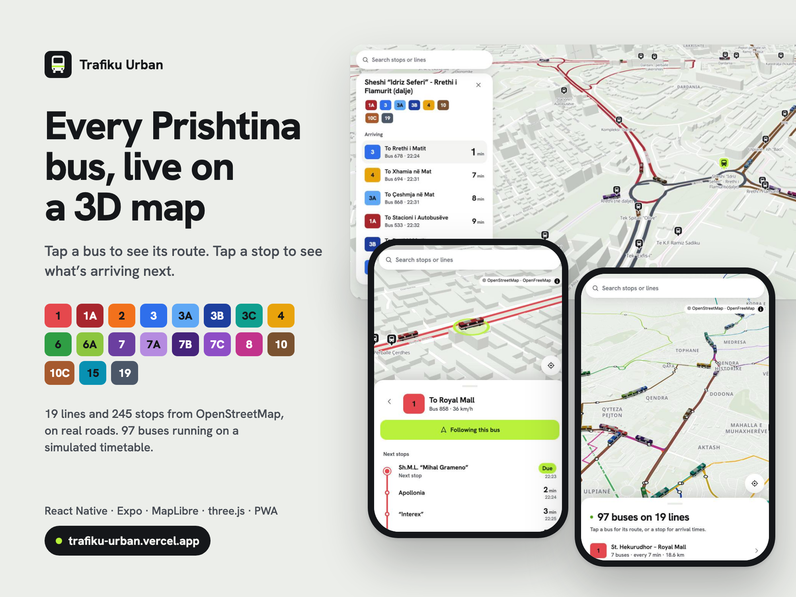

# Trafiku Urban

A live 3D map of Prishtina's city buses. All 19 Trafiku Urban lines drive their real routes. Tap a bus to see its route and next stops. Tap a stop to see what's arriving.

**Live demo: [trafiku-urban.vercel.app](https://trafiku-urban.vercel.app)**. On a phone, use "Add to Home Screen" and it opens full screen like an installed app.



It's one React Native (Expo) codebase. The same code runs as the hosted web app, and it can be built for the App Store and Google Play with EAS.

## What it does

- The map opens on Prishtina, tilted, with 3D buildings.
- 97 buses move along 19 lines (1, 1A, 2, 3, 3A, 3B, 3C, 4, 6, 6A, 7, 7A, 7B, 7C, 8, 10, 10C, 15, 19). Each line has its own colour. Variants of a line share a hue, so the 3s are blues and the 7s are purples.
- Tapping a bus highlights its route, dims the other lines and follows the bus with the camera. The panel lists its next stops with minutes and clock times.
- Tapping a stop shows the next six arrivals across every line that serves it, soonest first.
- Search is accent-insensitive, so "deshmoret" finds "Dëshmorët" and "3c" finds line 3C.
- The locate button jumps to the stop nearest to you. Outside Prishtina it falls back to the city centre.
- All 245 stops sit on the road. Each one is a real OpenStreetMap bus stop, projected onto the route geometry.

<p>
  
  
</p>

## The bus positions are simulated

Prishtina has no public real-time GPS feed, so the buses run on a timetable that I generate. Each bus speeds up from a stop, cruises at 26 to 38 km/h, brakes into the next stop and waits 10 to 26 seconds. Positions come from the wall clock, so two people opening the app at the same time see the same buses in the same places. The live state costs zero network requests.

The routes and stops are real. The timing is not. The app says so in the home panel.

## How the data is built

`scripts/build-network.mjs` produces `src/data/network.json` (188 KB). It runs once at dev time, not in the app.

1. It pulls the 33 Trafiku Urban route relations and every bus stop in the area from the OpenStreetMap Overpass API.
2. OSM relation members are often out of order, so it samples a point every 350 m along each relation's ways and orders the points as a path between the two farthest ends (nearest-neighbour, then 2-opt).
3. It routes through those points with OSRM. Each waypoint carries a bearing, so it snaps to the carriageway going the right way. Without that, dual carriageways produced U-turn detours: the airport line came out at 115 km.
4. When one leg is still much longer than the straight-line gap, it drops that waypoint and routes again.
5. It snaps OSM bus stops within 18 to 30 m of the route onto the line, then simplifies the geometry with Douglas-Peucker (1.2 m tolerance).

Run `npm run network` to rebuild it. Responses are cached in `scripts/cache/`. Add `-- --refresh` to fetch fresh data.

## Stack

| Part | What |
| --- | --- |
| App | Expo SDK 58, React Native 0.88, React 19 |
| UI motion | Reanimated 4 springs, Gesture Handler 3 |
| Map | MapLibre GL JS 6 with a custom style on OpenFreeMap vector tiles |
| Buses | three.js, one instanced mesh per line, drawn inside MapLibre's WebGL context |
| Web | `expo export -p web`, Workbox service worker, Vercel |

The map is an [Expo DOM component](https://docs.expo.dev/guides/dom-components/) (`src/map/MapDom.tsx`, `'use dom'`). On web it renders inline. On iOS and Android Expo hosts it in a native WebView, so the 3D map is the same code everywhere. The sheet, panels, search and buttons are native React Native views.

## Speed and data use

- An inline HTML skeleton paints in the first frame, before any JavaScript runs.
- MapLibre and the map style load as separate chunks. three.js (157 KB brotli) loads only after the base map has drawn.
- The critical path is about 700 KB brotli. On a repeat visit the service worker serves it from the device.
- Map tiles and fonts are cache-first for 30 days. OpenFreeMap tile URLs are versioned, so a cached tile never goes stale.
- The camera is bounded to Prishtina and the vector tiles stop at zoom 14, so panning around downloads very little.
- The style has no sprite sheet. Stop pins and the bus glyph are drawn on a canvas.
- All 97 buses render in 19 draw calls plus one for shadows.

## Design

The tokens live in `src/ui/theme.ts`:

- Neutrals with at least 5:1 text contrast.
- One accent (lime `#B8F23A`), used only for "live", "Due" and the primary action.
- A 4 pt spacing grid.
- Nested radii follow inner = outer - padding (sheet 24, card 16, chip 8).
- One typeface, Hanken Grotesk, with tabular numbers wherever a number changes.

Some choices from the motion and UX principles I worked to:

- **Anticipation and follow-through.** Buttons compress on press and spring back. A selected bus squashes, stretches, then settles.
- **Slow in, slow out.** Buses accelerate and brake around stops instead of moving at a constant speed.
- **Arcs.** Bus headings are eased, so turns trace curves. Camera moves use `flyTo` with a zoom arc.
- **Staging.** Selecting something dims everything unrelated. The followed bus is drawn in a second pass, so a building or an underpass never hides it.
- **Fitts's law.** Every row is at least 64 px tall, icon buttons are 48 px, and buses accept taps 30 px or more from their centre. Stop pins extend their hit area below the icon.
- **Hick's and Miller's laws.** The home list groups 19 lines by number, arrivals stop at six, and next stops stop at seven.
- **Doherty threshold.** Taps respond within a frame. The skeleton covers the map load.
- **Postel's law.** Search ignores accents, quotes and case. Typing "line 3" or "linja 3" works.
- **Jakob's law.** The layout follows ride-hailing apps people already know: full-screen map, search on top, draggable bottom sheet.
- **Reduced motion.** With the OS setting on, Reanimated and the CSS skeleton skip their animations.

## Run it

```bash
git clone https://github.com/alitinart/trafiku-urban
cd trafiku-urban
npm install
npx expo start        # press w for web, or scan the QR code with Expo Go
```

`npm install` also runs `scripts/sync-maplibre-worker.mjs`. MapLibre v6 locates its web worker through `import.meta.url`, which Metro doesn't provide, so the script copies the worker to `public/` for web and embeds a copy for the native WebView.

Other scripts:

```bash
npm run typecheck     # tsc --noEmit
npm run build:web     # expo export + service worker → dist/
npm run network       # rebuild route and stop data
npm run icons         # re-render app icons from SVG (needs Chrome)
```

## Deploy

The web build is on Vercel's free tier. `vercel.json` sets the build command, the output folder, SPA rewrites and long cache headers for hashed assets.

```bash
npx vercel deploy --prod
```

Publishing to the stores goes through EAS:

```bash
npx eas-cli@latest build --platform all
npx eas-cli@latest submit --platform ios
```

The bundle identifier and package name (`com.alitinart.trafikuurban`) and the location permission text are in `app.json`.

## Project layout

```
App.tsx                  screen: search, sheet, panels, navigation stack
src/map/MapDom.tsx       'use dom' wrapper around the map
src/map/MapView.tsx      MapLibre setup, layers, picking, camera, follow mode
src/map/busLayer.ts      three.js custom layer: bus models, instancing, selection
src/map/style.ts         map style
src/sim/simulation.ts    timetables, bus positions, ETAs
src/data/network.ts      route geometry helpers, line metadata
src/ui/                  design tokens, sheet, panels, primitives, icons
scripts/                 data pipeline, icon renderer, worker sync
```

## Credits

- Routes and stops: © [OpenStreetMap](https://www.openstreetmap.org/copyright) contributors, ODbL.
- Map tiles: [OpenFreeMap](https://openfreemap.org).
- Road routing during the build: [OSRM](https://project-osrm.org) demo server.
- Typeface: Hanken Grotesk, SIL Open Font License.

This is a portfolio project and isn't affiliated with Trafiku Urban or the Municipality of Prishtina.
