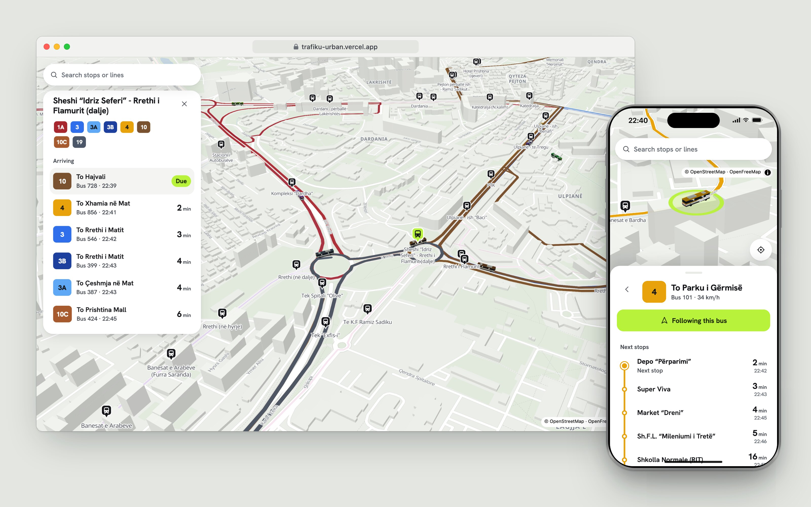
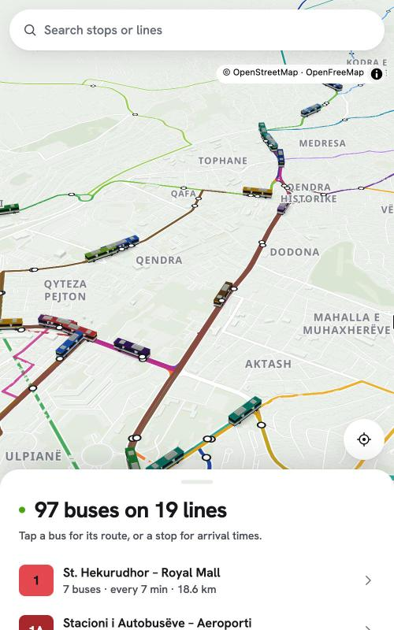
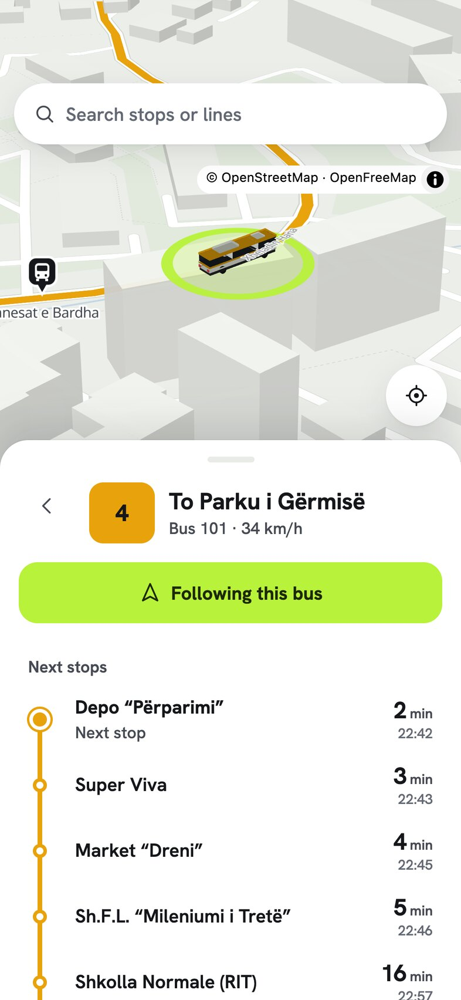

# Trafiku Urban

A live 3D map of Prishtina's city buses. All 19 Trafiku Urban lines drive their real routes. Tap a bus to see where it goes next. Tap a stop to see what's arriving.

**Live demo: [trafiku-urban.vercel.app](https://trafiku-urban.vercel.app)**. On a phone, use "Add to Home Screen" and it opens full screen like an installed app.



The app is one React Native codebase built with Expo. The same code runs as the hosted web app, and EAS can build it for the App Store and Google Play.

## What it does

- The map opens on Prishtina, tilted, with 3D buildings.
- 97 buses move along lines 1, 1A, 2, 3, 3A, 3B, 3C, 4, 6, 6A, 7, 7A, 7B, 7C, 8, 10, 10C, 15 and 19. Each line has its own colour. Variants share a hue, so the 3s are blues and the 7s are purples.
- Tapping a bus highlights its route, dims the other lines and follows the bus with the camera. The panel lists its next stops with minutes and clock times.
- Tapping a stop shows the next six arrivals across every line that serves it, soonest first.
- Search ignores accents, so "deshmoret" finds "Dëshmorët" and "3c" finds line 3C.
- The locate button jumps to the stop nearest to you. Outside Prishtina it falls back to the city centre.
- All 245 stops sit on the road. Each one is a real OpenStreetMap bus stop, moved onto the route line.

<p>
  
  
</p>

## The bus positions are simulated

Prishtina has no public real-time GPS feed, so the buses run on a timetable I generate. Each bus speeds up from a stop, cruises at 26 to 38 km/h, brakes into the next stop and waits 10 to 26 seconds. Positions come from the wall clock. Two people who open the app at the same moment see the same buses in the same places, and the live state costs zero network requests.

The routes and stops are real. The timing is not. The app says so in the home panel.

## How the data is built

`scripts/build-network.mjs` writes `src/data/network.json`, a 188 KB file. It runs once at dev time, never in the app.

1. It pulls the 33 Trafiku Urban route relations and every bus stop in the area from the OpenStreetMap Overpass API.
2. OSM relation members are often out of order. The script samples a point every 350 m along each relation's ways and orders the points as a path between the two farthest ends, using nearest-neighbour and then 2-opt.
3. It routes through those points with OSRM. Each waypoint carries a bearing, so it snaps to the carriageway going the right way. Before I added bearings, dual carriageways produced U-turn detours and the airport line came out at 115 km.
4. If one leg is still much longer than the straight-line gap, it drops that waypoint and routes again.
5. It moves every OSM bus stop within 18 to 30 m of the route onto the line, then simplifies the geometry with Douglas-Peucker at a 1.2 m tolerance.

Run `npm run network` to rebuild it. The script caches API responses in `scripts/cache/`. Add `-- --refresh` to fetch fresh data.

## Stack

| Part | What |
| --- | --- |
| App | Expo SDK 58, React Native 0.88, React 19 |
| UI motion | Reanimated 4 springs, Gesture Handler 3 |
| Map | MapLibre GL JS 6 with a custom style on OpenFreeMap vector tiles |
| Buses | three.js, one instanced mesh per line, drawn inside MapLibre's WebGL context |
| Web | `expo export -p web`, Workbox service worker, Vercel |

The map is an [Expo DOM component](https://docs.expo.dev/guides/dom-components/) in `src/map/MapDom.tsx`. On web it renders inline. On iOS and Android, Expo hosts it in a native WebView, so the 3D map is the same code everywhere. The sheet, panels, search and buttons are native React Native views.

## Speed and data use

- An inline HTML skeleton paints in the first frame, before any JavaScript runs.
- MapLibre and the map style load as separate chunks. three.js, 157 KB with brotli, loads only after the base map has drawn.
- The critical path is about 700 KB with brotli. On a repeat visit the service worker serves it from the device.
- Map tiles and fonts are cache-first for 30 days. OpenFreeMap tile URLs carry a version, so a cached tile never goes stale.
- The camera can't leave Prishtina and the vector tiles stop at zoom 14, so panning around downloads very little.
- The style has no sprite sheet. The app draws stop pins and the bus glyph on a canvas.
- All 97 buses render in 19 draw calls, plus one for shadows.

## Design

The tokens live in `src/ui/theme.ts`.

- Neutral colours keep text contrast at 5:1 or better.
- There is one accent, lime `#B8F23A`. It marks "live", "Due" and the primary action, and nothing else.
- Spacing sits on a 4 pt grid.
- Nested radii follow inner = outer - padding. The sheet is 24, cards are 16 and chips are 8.
- One typeface, Hanken Grotesk, with tabular numbers wherever a number changes.
- Each line badge picks dark or white text, whichever has more contrast on its colour.

These are the motion and UX principles that changed the build:

- **Anticipation and follow-through.** Buttons compress on press and spring back. A selected bus squashes, stretches, then settles.
- **Slow in, slow out.** Buses accelerate and brake around stops instead of moving at a constant speed.
- **Arcs.** The bus layer eases headings, so turns trace curves. Camera moves use `flyTo`, which arcs the zoom.
- **Staging.** Selecting something dims everything unrelated. The followed bus draws in a second pass, so a building or an underpass never hides it.
- **Fitts's law.** Every row is at least 64 px tall and icon buttons are 48 px. A tap within 30 px of a bus selects it. Stop pins extend their hit area below the icon.
- **Hick's and Miller's laws.** The home list groups the 19 lines by number. Arrivals stop at six and next stops at seven.
- **Doherty threshold.** Taps respond within a frame. The skeleton covers the map load.
- **Postel's law.** Search ignores accents, quotes and case. "line 3" and "linja 3" both work.
- **Jakob's law.** The layout copies ride-hailing apps people already know. The map fills the screen, search sits on top and details live in a draggable bottom sheet.
- **Reduced motion.** With the OS setting on, Reanimated and the CSS skeleton skip their animations.

## Run it

```bash
git clone https://github.com/alitinart/trafiku-urban
cd trafiku-urban
npm install
npx expo start        # press w for web, or scan the QR code with Expo Go
```

`npm install` also runs `scripts/sync-maplibre-worker.mjs`. MapLibre v6 finds its web worker through `import.meta.url`, which Metro doesn't provide. The script copies the worker to `public/` for web and embeds a copy for the native WebView.

Other scripts:

```bash
npm run typecheck     # tsc --noEmit
npm run build:web     # expo export + service worker → dist/
npm run network       # rebuild route and stop data
npm run icons         # re-render app icons from SVG (needs Chrome)
```

## Deploy

The web build runs on Vercel's free tier. `vercel.json` sets the build command, the output folder, SPA rewrites and long cache headers for hashed assets.

```bash
npx vercel deploy --prod
```

Publishing to the stores goes through EAS:

```bash
npx eas-cli@latest build --platform all
npx eas-cli@latest submit --platform ios
```

`app.json` holds the bundle identifier, the Android package name `com.alitinart.trafikuurban` and the location permission text.

## Project layout

```
App.tsx                  screen: search, sheet, panels, navigation stack
src/map/MapDom.tsx       'use dom' wrapper around the map
src/map/MapView.tsx      MapLibre setup, layers, picking, camera, follow mode
src/map/busLayer.ts      three.js custom layer: bus models, instancing, selection
src/map/style.ts         map style
src/sim/simulation.ts    timetables, bus positions, ETAs
src/data/network.ts      route geometry helpers, line metadata
src/ui/                  design tokens, sheet, panels, primitives, icons
scripts/                 data pipeline, icon renderer, worker sync
```

## Credits

Routes and stops come from © [OpenStreetMap](https://www.openstreetmap.org/copyright) contributors under the ODbL. Map tiles are from [OpenFreeMap](https://openfreemap.org). The build routes roads with the [OSRM](https://project-osrm.org) demo server. Hanken Grotesk is under the SIL Open Font License.

This is a portfolio project. It isn't affiliated with Trafiku Urban or the Municipality of Prishtina.
